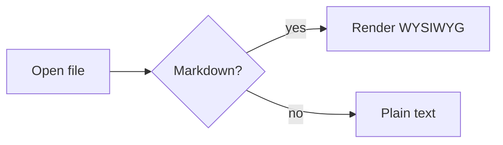

[TOC]

# mdnest Feature Tour

This paragraph has **bold**, *italic*, `inline code`, ~~strike~~, ==highlight== and a [link](https://example.com "Example"). Inline math: $E = mc^2$.

## Lists

- Bullet one
- Bullet two with **bold**
  - Nested item

1. First
2. Second

- [ ] Task to do
- [x] Task done

> A blockquote with *emphasis*.
>
> Second paragraph in quote.

---

## Table

| Feature | Status | Notes |
|:---|:---:|---:|
| Tables | done | basic |
| Math | done | MathJax 4 |

## Code

```javascript
function hello(name) {
  // greet
  return `Hello, ${name}!`;
}
```

```python
def fib(n):
    return n if n < 2 else fib(n - 1) + fib(n - 2)
```

## Math Block

$$
\int_0^1 x^2\,dx = \frac{1}{3}
$$

## Mermaid



## Image


### Heading 3

#### Heading 4

Final paragraph.
